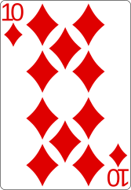
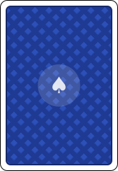
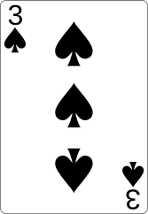
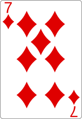
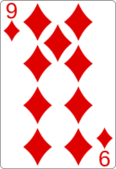

<!-- blackjack -->

🤖 링크를 누른 뒤 약 1분 후 새로고침(F5)해 주세요! 마지막 갱신: 2026-11-08 20:50 KST

<table>
<tr><th>Dealer</th><td> </td><td><b>?</b></td></tr>
<tr><th>Player</th><td>  </td><td><b>19</b></td></tr>
</table>

🪙 보유 칩 <b>868</b> · 베팅 <b>10</b>

 

<table>
<tr><th>행동</th><th>내용</th><th>플레이어</th></tr>
<tr><td>Hit</td><td>D9 받음 · 합계 19</td><td><a href="https://github.com/how-to-song">@how-to-song</a></td></tr>
<tr><td>Deal</td><td>새 판 시작 · 베팅 10 · 합계 10</td><td><a href="https://github.com/how-to-song">@how-to-song</a></td></tr>
<tr><td>Reset</td><td>칩을 🪙 878개로 설정 (최근 1년 기여 878)</td><td><a href="https://github.com/how-to-song">@how-to-song</a></td></tr>
</table>

<!-- /blackjack -->

  <h2 style="border-bottom: 1px solid #21262d; color: #c9d1d9;"> Tech Stacks </h2>

  <h3> Editor </h3>
  

  <h3> Language </h3>
  
  
  

## Hi there 👋
---
게임 개발자로 성장하고 싶은 송하우입니다.
---
## Projects

### [Once-upon-a-Dice](https://github.com/Jongeume/once-upon-a-dice) - Yacht Dice 기반의 덱빌딩 RPG
한줄 설명
- 세부 설명
- 세부 설명

---
## Skills
- **Editor:** Unity
- **Language:** C, C#, Java, Python

---
## Let's connect

<!--
**how-to-song/how-to-song** is a ✨ _special_ ✨ repository because its `README.md` (this file) appears on your GitHub profile.

Here are some ideas to get you started:

- 🔭 I’m currently working on ...
- 🌱 I’m currently learning ...
- 👯 I’m looking to collaborate on ...
- 🤔 I’m looking for help with ...
- 💬 Ask me about ...
- 📫 How to reach me: ...
- 😄 Pronouns: ...
- ⚡ Fun fact: ...
-->
